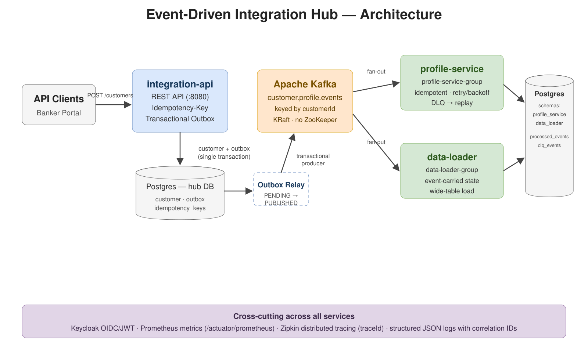

# Event-Driven Integration Hub

A **Spring Boot 3 + Kafka** event-driven integration hub that demonstrates the reliability patterns used in real-world banking integrations — built end to end: REST API, transactional outbox, Kafka streaming, idempotent consumers, DLQ with replay, security, observability, testing, CI/CD and Kubernetes deployment.

> Personal project — a miniature of a banking "Customer 360" scenario: one channel-facing API emits a canonical event stream consumed independently by multiple downstream systems, with guarantees of **no loss, no duplication and full replayability**.

## Skills demonstrated

| Capability | Implementation in this project |
| --- | --- |
| **Integration & API design** | Channel-facing REST API (springdoc-openapi 3), canonical event model, event-driven integration, event fan-out to independent downstream systems |
| **Messaging reliability** | Transactional Outbox pattern (eliminates dual-write), Kafka producer with transactions, idempotent consumers, retry/backoff, Dead-Letter Queue with manual replay, multiple independent consumer groups |
| **Security** | OAuth2 Resource Server with JWT (Keycloak), role-based access (`BANKER` role for writes), 401/403 handling, TLS-ready |
| **Testing & quality** | JUnit 5, AssertJ, **Testcontainers** (PostgreSQL + Kafka), integration tests covering the full event path |
| **CI/CD** | GitHub Actions: build → Testcontainers tests → non-root images to GHCR → `kind` Kubernetes smoke deploy on every push |
| **Cloud-native & containers** | Multi-stage non-root Docker images (OpenShift-friendly), Kubernetes/kustomize manifests, ConfigMaps/Secrets, readiness/liveness probes, CPU-based HPA |
| **Observability** | Structured JSON logs with MDC correlation IDs, Micrometer + Prometheus metrics, distributed tracing (Micrometer Tracing + Zipkin), health checks |
| **Data & migrations** | PostgreSQL 16, Flyway versioned migrations, event-carried state transfer in the data-loader consumer |
| **Troubleshooting** | Root-cause write-up of five real Kubernetes smoke-deploy issues ([docs/k8s-smoke-fixes.md](docs/k8s-smoke-fixes.md)) |

## Architecture



One channel-facing REST API writes business data and an outbox record in one transaction; an outbox relay publishes canonical events to Kafka; two independent consumer groups process them:

- `services/integration-api` — REST API + transactional outbox (:8080)
- `services/profile-service` — "core system" consumer: idempotency, retry, DLQ, replay (:8081)
- `services/data-loader` — "data platform" consumer: event-carried state, own schema (:8082)

Design rationale: [docs/design.md](docs/design.md) · Decisions: [docs/decisions.md](docs/decisions.md) · Editable diagram: [docs/architecture.drawio](docs/architecture.drawio)

## Tech stack

Java 21 · Spring Boot 3.5 · Maven multi-module · Kafka 4 (KRaft) · PostgreSQL 16 · Flyway · Spring Security OAuth2 (JWT/Keycloak) · springdoc-openapi · ProblemDetail (RFC 9457) · Micrometer/Prometheus · Zipkin · Testcontainers · Docker · Kubernetes · GitHub Actions

## Quick start

Prerequisites: Docker Desktop, JDK 21 (Maven wrapper included).

```bash
cp .env.example .env
docker compose up -d                     # PostgreSQL + Kafka (KRaft)
./scripts/init-kafka.sh                  # create topics
cd services && ./mvnw -pl integration-api spring-boot:run
```

Send an event (with Keycloak disabled, local dev profile):

```bash
curl -X POST http://localhost:8080/api/v1/customers \
  -H "Idempotency-Key: demo-001" -H "Content-Type: application/json" \
  -d '{"customerId":"CUS-0001","name":"Jane Doe","email":"jane@example.com","phone":"+64 21 000 0000","addresses":[],"kycStatus":"PENDING"}'
```

Watch the full path: outbox → Kafka → both consumers → both stores. Break a consumer on purpose to observe retry → DLQ → replay.

## Security demo (Keycloak JWT)

```bash
docker compose --profile security up -d   # Keycloak on :8088

TOKEN=$(curl -s -X POST http://localhost:8088/realms/hub/protocol/openid-connect/token \
  -d grant_type=password -d client_id=integration-api \
  -d username=banker -d password=banker-dev | jq -r .access_token)

curl -X POST http://localhost:8080/api/v1/customers \
  -H "Authorization: Bearer $TOKEN" -H "Idempotency-Key: demo-002" \
  -H "Content-Type: application/json" \
  -d '{"customerId":"CUS-0002","name":"John Smith","email":"john@example.com","phone":"+64 22 000 0000","addresses":[],"kycStatus":"PENDING"}'
```

No token → 401; valid token without `BANKER` role → 403. Swagger UI has an Authorize button for the Bearer token.

## Kubernetes

```bash
kind create cluster --name hub
kubectl apply -k k8s/
kubectl -n hub rollout status deployment/integration-api --timeout=240s
```

CI runs this smoke deploy on every `main` push (Keycloak JWT → POST customer → expect 202). Production notes: use the Strimzi Operator for Kafka, External Secrets/Vault for secrets, and metrics-server for HPA.

## Status

- [x] M0 scaffold, infra compose, multi-module Maven
- [x] M1 REST API + JPA + Flyway + OpenAPI + transactional outbox + Testcontainers
- [x] M2 outbox relay → Kafka, idempotent consumer, retry/DLQ/replay
- [x] M3 second consumer group, observability, non-root images, GHCR publishing
- [x] M4 Keycloak JWT, Kubernetes manifests, kind smoke deploy in CI
